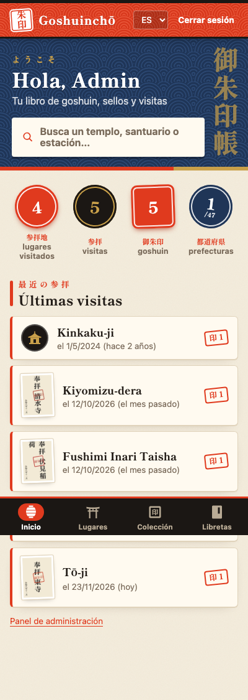
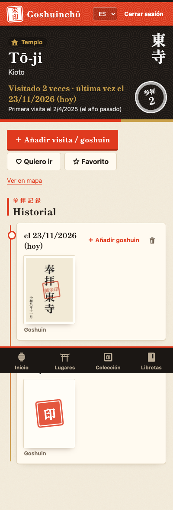
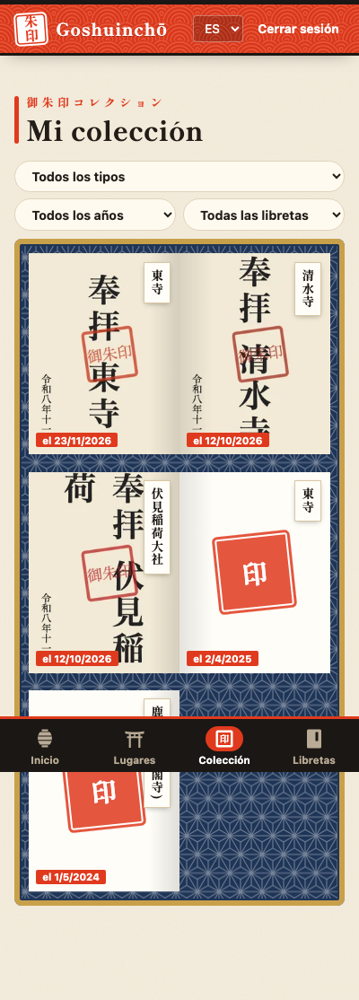
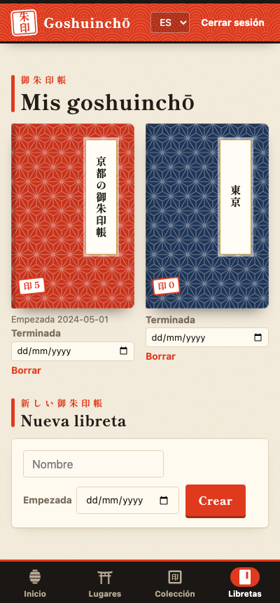

# Goshuinchō 御朱印帳

A self-hosted progressive web app for logging your visits to Japanese shrines, temples and stations, together with the **goshuin** (御朱印) and stamps you collect there.

<p align="center">
  
  
  
  
</p>

## Features

- **Places from OpenStreetMap:** every shrine, temple and station in Japan, imported by region. Users can propose new places and corrections, which an admin reviews.
- **Visits and goshuin:** log a visit in a few taps, add a photo of the goshuin and organise them into your goshuinchō books.
- **Offline map:** a single [PMTiles](https://docs.protomaps.com/pmtiles/) file served by the app itself. There is no tile server and no third-party requests.
- **Pilgrimage routes:** track your progress, for example 3/33 on the Saigoku Kannon pilgrimage.
- **Statistics:** monthly streaks, a visit calendar, a prefecture map and goshuin per year.
- **Kanji reading assist:** transcribe a goshuin's inscription to get furigana, rōmaji and a short glossary, computed locally.
- **Works offline:** recent data is cached, and visits and photos logged without signal are uploaded once you're back online.
- **Share your collection** through read-only links that can be revoked.
- **Your data is portable:** export everything (data and original photos) as a ZIP and import it into another instance.
- **Multi-user,** with an admin panel. The app is available in English and Spanish; the admin panel is in Spanish only.

## Quick start

You need Docker with Compose and a reverse proxy that terminates HTTPS. The PWA, offline mode and the camera only work over HTTPS (or on `localhost`).

```sh
git clone https://github.com/Jaumoso/Goshuincho.git && cd Goshuincho
cp .env.example .env    # fill in PUBLIC_URL, SECRET_KEY, DB_PASSWORD, ADMIN_EMAIL and ADMIN_PASSWORD
mkdir -p tiles
docker compose up -d --build
```

The `migrate` service applies database migrations, loads Japan's regions and prefectures, and creates the admin user. After that, `app` and `worker` start, and the app listens on `127.0.0.1:8000`.

| Path | What |
|---|---|
| `/` | The app |
| `/admin/` | Admin panel |
| `/api/docs` | API reference (OpenAPI) |
| `/api/health` | Health check |

> The `postgis/postgis` image is published for amd64 only. On ARM (Apple Silicon, Raspberry Pi) it runs under emulation, or you can set another compatible image in `POSTGIS_IMAGE`.

### Reverse proxy

The proxy must forward `X-Forwarded-Proto` and allow uploads up to `MAX_UPLOAD_MB`. Its address must also be included in `TRUSTED_PROXIES`.

Caddy:

```
goshuin.example.com {
    encode zstd gzip
    request_body {
        max_size 25MB
    }
    reverse_proxy 127.0.0.1:8000
}
```

nginx:

```nginx
location / {
    proxy_pass http://127.0.0.1:8000;
    proxy_set_header Host $host;
    proxy_set_header X-Forwarded-For $proxy_add_x_forwarded_for;
    proxy_set_header X-Forwarded-Proto $scheme;
    client_max_body_size 25m;
}
```

### Configuration

| Variable | Required | Description |
|---|---|---|
| `PUBLIC_URL` | yes | Public URL of the app, e.g. `https://goshuin.example.com` |
| `SECRET_KEY`, `DB_PASSWORD` | yes | Long random values, e.g. `openssl rand -base64 48` |
| `ADMIN_EMAIL`, `ADMIN_PASSWORD` | yes | First admin user, created on startup if it doesn't exist |
| `TRUSTED_PROXIES` | | IPs or networks of your proxy (default in `.env.example` includes Docker's networks) |
| `BIND_ADDRESS`, `PORT` | | Where the app listens (default `127.0.0.1:8000`) |
| `MAX_UPLOAD_MB` | | Upload limit (default 25) |
| `KEEP_ORIGINAL_EXIF` | | Keep the EXIF data of original photos (default `true`) |
| `POSTGIS_IMAGE` | | Alternative PostGIS image |

## Base map (optional, recommended)

Extract Japan from a daily Protomaps build. Pick a date from [builds.json](https://build-metadata.protomaps.dev/builds.json):

```sh
docker run --rm -v ./tiles:/tiles protomaps/go-pmtiles extract \
  https://build.protomaps.com/20261123.pmtiles /tiles/japan.pmtiles \
  --bbox=122.9,24.0,146.0,45.6 --maxzoom=14
```

| `--maxzoom` | Approx. size | Detail |
|---|---|---|
| 12 | 400 MB | cities and roads |
| 13 | 860 MB | main streets |
| 14 | 1.7 GB | streets and buildings (recommended) |
| 15 | 3.7 GB | maximum |

Without this file the map still works, but it shows only the places, with no background.

## Loading places

Shrines, temples and stations are imported from OpenStreetMap by region, using the [Geofabrik](https://download.geofabrik.de/asia/japan.html) extracts. These range from 90 MB for Shikoku to about 1 GB for Kantō, and are filtered locally.

To import from the admin panel:

1. Go to *Geografía › Regiones*.
2. Select the regions and run **Importar de OpenStreetMap** (Import from OpenStreetMap).

The worker downloads and imports them in the background, and you can follow the progress under *Lugares › Importaciones de OpenStreetMap*.

From the command line:

```sh
docker compose exec app python manage.py seed --if-empty           # categories (pilgrimages, deities…)
docker compose exec app python manage.py import_osm kansai shikoku  # or "all"; --file for a downloaded .osm.pbf
```

Re-importing does the following:

- Places are updated by their OSM id.
- Places edited by hand are never overwritten.
- Places that disappear from OSM are flagged, not deleted.
- Missing rōmaji is generated automatically.

### Importing from CSV

You can also load places from a CSV file:

```sh
docker compose exec app python manage.py import_places_csv --sample   # 36 sample places
docker compose exec app python manage.py import_places_csv /path/places.csv
```

The columns are `kind,name_ja,name_romaji,name_en,prefecture,lat,lon,categories`:

- `kind` is one of `shrine`, `temple`, `station` or `site`.
- `prefecture` accepts an ISO code, an id or a name. If it is empty, the prefecture is derived from the coordinates.
- `categories` is a list of slugs separated by `;`, each with an optional order, e.g. `saigoku-kannon:16`.

### Moderation

Places created by users stay private until an admin reviews them under *Lugares › Cola de revisión* (review queue). The admin can approve a place, reject it, or merge it into an existing duplicate; nearby places with similar names are suggested. Corrections proposed for approved places appear under *Lugares › Propuestas de corrección*, with a "current → proposed" diff.

## Backups

The per-user export doesn't replace server backups. Back up both the database and the `media` volume, for example with [restic](https://restic.net/):

```sh
export RESTIC_REPOSITORY=sftp:backup@nas:/goshuincho RESTIC_PASSWORD_FILE=~/.restic-pass
docker compose exec -T db pg_dump -U goshuin -Fc goshuin > goshuin.dump
restic backup goshuin.dump "$(docker volume inspect -f '{{ .Mountpoint }}' goshuincho_media)"
restic forget --keep-daily 7 --keep-weekly 4 --keep-monthly 12 --prune
```

To restore:

1. Run `restic restore latest --target /tmp/r`.
2. Copy the media files back into the volume.
3. Load the database: `docker compose exec -T db pg_restore -U goshuin -d goshuin --clean --if-exists < goshuin.dump`.

Test a restore at least once.

## Development

- `backend/`: Django, django-ninja and GeoDjango, managed with [uv](https://docs.astral.sh/uv/).
- `frontend/`: React, Vite and TypeScript.

GeoDjango needs GDAL, GEOS and PROJ. If you don't have them installed, use the containers:

```sh
docker compose -f docker-compose.test.yml run --rm --build tests                          # backend tests (with PostGIS)
docker compose -f docker-compose.test.yml run --rm tests python manage.py makemigrations  # new migrations
cd frontend && npm install && npm run dev                                                 # frontend with hot reload, against localhost:8000
```

The full functional and technical specification is in [`docs/especificacion.md`](docs/especificacion.md) (in Spanish).

## Data and attribution

- Places and base map: © [OpenStreetMap](https://www.openstreetmap.org/copyright) contributors, ODbL. Tiles by [Protomaps](https://protomaps.com).
- Prefecture boundaries: [Natural Earth](https://www.naturalearthdata.com/), public domain.
- Map font: Noto Sans, SIL Open Font License (`frontend/public/map/fonts/OFL.txt`).
