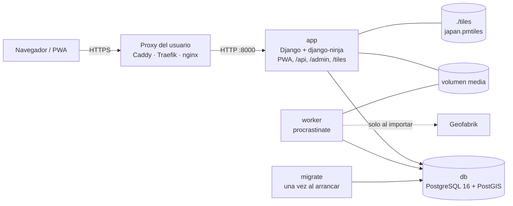

# Goshuinchō — Especificación de la aplicación selfhosted

Rev. 2 · Nov 23, 2026 · @Jaume (rev. 1: Oct 21, 2026). Los cambios respecto a la rev. 1 se resumen en la sección 9.

## 1. Visión, alcance y glosario

Goshuinchō es una web app (PWA) selfhosted con Docker para llevar el registro de los lugares visitados en Japón y de los goshuin y sellos conseguidos en cada visita, con varias visitas y varios goshuin por lugar.

**Objetivos**

- Registrar visitas a santuarios, templos budistas, estaciones de tren y otros sitios con sello.
- Guardar la foto o el escaneo de cada goshuin o sello, ligado a la visita en la que se consiguió (o al envío por correo o evento por el que se recibió).
- Explorar la colección por tipo de lugar, categoría, prefectura, región y zona, en lista y en mapa.
- Mostrar el historial de cada lugar: «visitado el 12/10/2025» y «hace 1 año».
- Desplegarse con `docker compose up` en un servidor propio, detrás del proxy HTTPS que ya tenga el usuario, sin servicios externos obligatorios.

**Fuera de alcance en la v1**

- App nativa iOS/Android (la PWA cubre el uso en móvil).
- Red social pública, comentarios entre usuarios o marketplace.
- Lectura automática del kanji del goshuin (OCR); queda como mejora futura.
- Uso sin conexión, incluida la cola de subida de fotos; previsto para la v2. La API ya acepta identificadores generados en el cliente para que la v2 no requiera cambios de modelo.
- Proxy HTTPS incluido: cada instalación usa el suyo (Caddy, Traefik, nginx…).

**Glosario**

| Término | Significado |
| --- | --- |
| Goshuin (御朱印) | Sello y caligrafía que se recibe en un santuario o templo como prueba de visita |
| Goshuinchō (御朱印帳) | Libreta física donde se guardan los goshuin |
| Jinja (神社) | Santuario sintoísta |
| Tera / -ji (寺) | Templo budista |
| Jikigaki (直書き) | Goshuin escrito directamente en la libreta |
| Kakioki (書き置き) | Goshuin escrito de antemano en hoja suelta, que se pega después |
| Yūsō (郵送) | Goshuin recibido por correo, sin visita en persona |
| Eki stamp (駅スタンプ) | Sello de recuerdo disponible en una estación de tren |
| Hatsuho-ryō (初穂料) / nōkyō-ryō (納経料) | Donativo que se entrega al recibir el goshuin |
| Prefectura (県・都・道・府) | División administrativa de primer nivel; Japón tiene 47 |

## 2. Usuarios y requisitos

La app es multiusuario: el catálogo de lugares es común, y las visitas, goshuin y fotos son privados de cada usuario.

**Roles**

| Rol | Puede |
| --- | --- |
| Administrador | Gestionar usuarios, crear y editar lugares aprobados, importar catálogo, revisar lugares propuestos (v1.1), hacer backups |
| Usuario | Registrar visitas, goshuin y sellos; crear lugares privados; exportar sus datos |
| Invitado (opcional, v2) | Ver una colección que un usuario haya compartido por enlace de solo lectura |

**Requisitos funcionales**

| ID | Requisito | Prioridad |
| --- | --- | --- |
| RF-01 | Catálogo de lugares con tipo: santuario, templo, estación u otro sitio | MVP |
| RF-02 | Filtrar por tipo, categoría, prefectura, región y zona | MVP |
| RF-03 | Registrar varias visitas por lugar, cada una con fecha y precisión (día, mes, estación, año o desconocida) | MVP |
| RF-04 | Registrar uno o varios goshuin o sellos por visita, con tipo, medio y notas; la visita puede ser en persona, por correo o en un evento | MVP |
| RF-05 | Subir foto o escaneo del goshuin, con anverso y reverso opcionales | MVP |
| RF-06 | Mostrar «visitado el …» y «hace X» según la última visita en persona, y el número total de visitas | MVP |
| RF-07 | Línea temporal de un lugar con todas las visitas y la evolución de sus goshuin | MVP |
| RF-08 | Mapa con lugares visitados, pendientes y sin visitar | MVP |
| RF-09 | Lista de deseos y favoritos por usuario | MVP |
| RF-12a | Crear un lugar que falta, privado para quien lo crea, con aviso de posibles duplicados | MVP |
| RF-10 | Categorías temáticas y rutas de peregrinaje con progreso (por ejemplo 12 de 88) | v1.1 |
| RF-11 | Libretas (goshuinchō) con nombre y fechas, y asignar cada goshuin a una libreta | v1.1 |
| RF-12b | Cola de revisión del administrador: aprobar, fusionar o rechazar lugares propuestos | v1.1 |
| RF-13 | Estadísticas: lugares por prefectura, goshuin por año, rachas y mapa de calor | v1.1 |
| RF-14 | Exportar e importar datos propios en JSON y ZIP con imágenes | v1.1 |
| RF-15 | Compartir una colección por enlace de solo lectura | v2 (hecho) |
| RF-16 | Uso sin conexión: cola local de visitas, goshuin y fotos que se sincroniza al volver la conexión | v2 (hecho) |
| RF-17 | Proponer correcciones de lugares aprobados (datos, ubicación, comentario) que el administrador aplica o rechaza | v2 (hecho) |

**Requisitos no funcionales**

- **Despliegue:** una única imagen publicada y un `docker-compose.yml`, configuración por variables de entorno, arranque en menos de 2 minutos.
- **HTTPS obligatorio:** lo pone el proxy del usuario. Sin HTTPS (salvo en `localhost`) la PWA no se instala ni puede usar cámara ni geolocalización.
- **Móvil primero:** interfaz usable con una mano en el templo, con subida de foto desde la cámara en dos toques.
- **Rendimiento:** listados paginados, mapa con agrupación de puntos y miniaturas generadas en segundo plano.
- **Privacidad:** datos solo en el servidor del usuario, sin analítica ni servicios de terceros por defecto.
- **Idiomas:** interfaz en español e inglés; nombres de lugares en japonés, romaji e inglés.
- **Portabilidad:** los datos deben poder salir íntegros en formatos abiertos.

## 3. Casos de uso

Hay ocho casos de uso principales; el CU-02 y el CU-03 son los de uso diario y deben resolverse en pocos toques desde el móvil.

**CU-01 · Buscar un lugar**

- Actor: usuario. Precondición: sesión iniciada.
- Flujo: busca por nombre (japonés, romaji, inglés) o toca el mapa; filtra por tipo, categoría, prefectura, región o zona; abre la ficha.
- Resultado: la ficha muestra datos del lugar, estado personal (visitado, en lista de deseos, favorito) y las visitas anteriores.

**CU-02 · Registrar una visita**

- Flujo principal: desde la ficha (o «Estoy aquí» con geolocalización) pulsa «Añadir visita»; la fecha propone hoy; guarda.
- Variante «visita antigua»: elige precisión mes, estación o año si no recuerda el día (por ejemplo «verano de 2019»), o «fecha desconocida».
- Variante «sin ir en persona»: en «Más opciones» elige «Por correo» o «En un evento» (con el lugar del evento, por ejemplo unos grandes almacenes). Estas visitas no marcan el lugar como visitado.
- Reglas: la fecha no puede ser posterior a hoy en hora de Japón (`Asia/Tokyo`); un lugar admite cualquier número de visitas; dos visitas el mismo día piden confirmación.

**CU-03 · Añadir goshuin o sello a una visita**

- Flujo principal: dentro de una visita pulsa «Añadir goshuin»; hace una foto o sube un escaneo; elige tipo (goshuin, edición limitada, estacional, sello de estación) y medio (en libreta, hoja suelta); opcionalmente título, donativo y notas; guarda.
- Atajo: desde la ficha pulsa «Conseguí un goshuin»; si no hay visita en persona de hoy, la app la crea automáticamente.
- Una visita puede tener varios goshuin (por ejemplo salón principal y capilla secundaria).

**CU-04 · Ver la evolución de un lugar**

- Flujo: en la ficha abre «Historial»; ve la línea temporal con cada visita (en persona, por correo o en evento), sus fotos y sus goshuin.
- Resultado: puede comparar cómo cambió el diseño del goshuin entre visitas.
- Cabecera de la ficha: «Visitado 3 veces · última vez el 12/10/2025 (hace 1 año)».

**CU-05 · Registrar un sello de estación**

- Flujo: busca la estación (tipo «estación»); si no existe en el catálogo, la crea (CU-07); añade visita y un sello de tipo «sello de estación» con foto.
- Las estaciones usan los mismos modelos que los templos; solo cambia el tipo de lugar y el catálogo de categorías.

**CU-06 · Explorar la colección**

- Vistas: cuadrícula de goshuin, lista de lugares y mapa.
- Filtros combinables: tipo de lugar, categoría, prefectura, región, zona, estado (visitado, en lista de deseos, sin visitar), año de visita, con o sin goshuin.
- Resultado: contadores por prefectura y región, por ejemplo «Kioto: 14 lugares, 11 goshuin».

**CU-07 · Crear un lugar que falta** (MVP) **y revisarlo** (v1.1)

- Flujo (MVP): pulsa «Falta un lugar»; indica tipo, al menos un nombre (japonés, romaji o inglés) y la posición en el mapa; la prefectura se deduce del punto y se puede corregir.
- Antes de guardar, la app muestra lugares con nombre parecido y cercanos («¿Es alguno de estos?») para evitar duplicados.
- El lugar queda en estado `pending`: solo lo ve quien lo creó, que puede usarlo con normalidad (visitas, goshuin, lista de deseos) y editarlo, o borrarlo mientras no tenga visitas.
- Revisión (v1.1): el administrador lo aprueba, lo fusiona con un duplicado o lo rechaza. Al fusionar, las visitas y goshuin del usuario pasan al lugar destino.

**CU-08 · Exportar o importar datos** (v1.1)

- Flujo: ajustes, «Exportar» genera un ZIP con JSON e imágenes originales; «Importar» lo restaura en otra instancia.
- También importa CSV de lugares para el administrador.

## 4. Modelo de datos

La jerarquía central es lugar → visita → goshuin o sello → imagen: cada visita cuelga de un lugar, cada goshuin cuelga de la visita en que se consiguió, y así el mismo templo puede acumular varios goshuin a lo largo del tiempo. La base de datos es PostgreSQL 16 con PostGIS.

| Entidad | Qué guarda | Relaciones |
| --- | --- | --- |
| `users` | Cuenta, rol, idioma | 1 usuario → N visitas |
| `regions`, `prefectures`, `areas` | Geografía: 8 regiones, 47 prefecturas (con contorno) y zonas locales (Kioto ciudad, Hakone) | región → prefectura → zona |
| `places` | Catálogo común: santuario, templo, estación u otro sitio | N:1 prefectura, N:1 zona, N:M categorías |
| `categories` | Rutas de peregrinaje, temas y colecciones | N:M lugares, con número de orden en la ruta |
| `user_places` | Lista de deseos, favorito y notas personales | usuario × lugar |
| `visits` | Cada vez que el usuario fue (o recibió un goshuin por correo o en un evento), con fecha y precisión | lugar → N visitas |
| `stamps` | Goshuin o sello conseguido en una visita | visita → N goshuin |
| `media`, `stamp_media`, `visit_media` | Fotos y escaneos, con miniaturas | goshuin → N imágenes |
| `goshuincho` | Libretas físicas del usuario | libreta → N goshuin |

**Esquema SQL de referencia**

El esquema se implementa con modelos de Django (GeoDjango) y sus migraciones. Las restricciones que el ORM no expresa (claves foráneas compuestas, `ON DELETE`/`ON UPDATE` en base de datos, `CHECK` complejos) se crean con `RunSQL` en las migraciones; en los modelos, esas relaciones se declaran con `on_delete=DO_NOTHING` y `db_constraint=False` para que manden las de la base de datos. La tabla `users` es el modelo de usuario propio de Django (`password` guarda el hash argon2id en el formato de Django).

```sql
CREATE EXTENSION IF NOT EXISTS postgis;
CREATE EXTENSION IF NOT EXISTS pg_trgm;

CREATE TYPE place_kind     AS ENUM ('shrine','temple','station','site');
CREATE TYPE stamp_kind     AS ENUM ('goshuin','goshuin_limited','goshuin_seasonal','station_stamp','other_stamp');
CREATE TYPE stamp_medium   AS ENUM ('jikigaki','kakioki','stamped_paper','digital','other');
CREATE TYPE date_precision AS ENUM ('day','month','season','year','unknown');
CREATE TYPE visit_kind     AS ENUM ('in_person','mail','event');
CREATE TYPE review_status  AS ENUM ('approved','pending','rejected','merged');
CREATE TYPE user_role      AS ENUM ('admin','user');

CREATE TABLE users (
  id uuid PRIMARY KEY DEFAULT gen_random_uuid(),
  email text UNIQUE NOT NULL,
  display_name text NOT NULL,
  password text,                         -- argon2id (formato Django); NULL si entra por OIDC
  oidc_subject text UNIQUE,
  role user_role NOT NULL DEFAULT 'user',
  locale text NOT NULL DEFAULT 'es',
  created_at timestamptz NOT NULL DEFAULT now()
);

CREATE TABLE regions (
  id smallint PRIMARY KEY,
  slug text UNIQUE NOT NULL,             -- 'kansai'
  name_ja text NOT NULL, name_en text NOT NULL, name_es text NOT NULL
);

CREATE TABLE prefectures (
  id smallint PRIMARY KEY,               -- 1..47 (JIS X 0401)
  iso_code text UNIQUE NOT NULL,         -- 'JP-26'
  region_id smallint NOT NULL REFERENCES regions,
  name_ja text NOT NULL, name_romaji text NOT NULL, name_en text NOT NULL, name_es text NOT NULL,
  centroid geography(Point,4326),
  boundary geometry(MultiPolygon,4326)   -- contorno simplificado, para asignar prefectura y mapas de calor
);
CREATE INDEX prefectures_boundary_idx ON prefectures USING gist (boundary);

CREATE TABLE areas (                     -- zonas locales dentro de una prefectura
  id serial PRIMARY KEY,
  prefecture_id smallint NOT NULL REFERENCES prefectures,
  slug text UNIQUE NOT NULL,
  name_ja text, name_en text NOT NULL, name_es text
);

CREATE TABLE places (
  id uuid PRIMARY KEY DEFAULT gen_random_uuid(),
  kind place_kind NOT NULL,
  name_ja text,
  name_romaji text, name_en text,
  name_romaji_generated boolean NOT NULL DEFAULT false,  -- romaji generado automáticamente (pykakasi)
  alt_names text[] NOT NULL DEFAULT '{}',
  tradition text,                        -- templo: secta (Shingon, Zen...); santuario: Inari, Hachiman...
  operator text,                         -- estaciones: JR East, Kintetsu...
  prefecture_id smallint NOT NULL REFERENCES prefectures,
  area_id integer REFERENCES areas,
  address text,
  location geography(Point,4326),
  website text,
  goshuin_available boolean,             -- NULL = desconocido
  goshuin_info text,                     -- horario de la oficina, donativo, notas
  osm_type text, osm_id bigint,
  osm_missing boolean NOT NULL DEFAULT false,      -- ya no aparece en el último extracto de OSM
  locally_modified boolean NOT NULL DEFAULT false, -- editado por el administrador; la reimportación no lo pisa
  source text NOT NULL DEFAULT 'manual', -- 'osm' | 'csv' | 'manual' | 'user'
  status review_status NOT NULL DEFAULT 'approved',
  merged_into uuid REFERENCES places,
  created_by uuid REFERENCES users ON DELETE SET NULL,
  created_at timestamptz NOT NULL DEFAULT now(),
  updated_at timestamptz NOT NULL DEFAULT now(),
  CHECK (coalesce(name_ja, name_romaji, name_en) IS NOT NULL),
  CHECK ((status = 'merged') = (merged_into IS NOT NULL))
);
CREATE INDEX places_geo_idx    ON places USING gist (location);
CREATE INDEX places_filter_idx ON places (kind, prefecture_id, area_id);
CREATE INDEX places_name_trgm  ON places USING gin
  ((coalesce(name_ja,'') || ' ' || coalesce(name_romaji,'') || ' ' || coalesce(name_en,'')) gin_trgm_ops);
CREATE UNIQUE INDEX places_osm_uniq ON places (osm_type, osm_id) WHERE osm_id IS NOT NULL;

CREATE TABLE categories (
  id serial PRIMARY KEY,
  slug text UNIQUE NOT NULL,
  type text NOT NULL CHECK (type IN ('pilgrimage','theme','deity','collection')),
  name_ja text, name_en text NOT NULL, name_es text,
  description text,
  total_items integer                    -- p. ej. 88 en el Shikoku Henro
);
CREATE TABLE place_categories (
  place_id uuid    REFERENCES places ON DELETE CASCADE,
  category_id int  REFERENCES categories ON DELETE CASCADE,
  seq integer,                           -- número del lugar dentro de la ruta
  PRIMARY KEY (place_id, category_id)
);

CREATE TABLE user_places (
  user_id  uuid REFERENCES users ON DELETE CASCADE,
  place_id uuid REFERENCES places ON DELETE CASCADE,
  wishlist boolean NOT NULL DEFAULT false,
  favorite boolean NOT NULL DEFAULT false,
  notes text,
  PRIMARY KEY (user_id, place_id)
);

CREATE TABLE goshuincho (
  id uuid PRIMARY KEY DEFAULT gen_random_uuid(),
  user_id uuid NOT NULL REFERENCES users ON DELETE CASCADE,
  name text NOT NULL,
  description text,
  started_on date, finished_on date,
  UNIQUE (id, user_id)
);

CREATE TABLE visits (
  id uuid PRIMARY KEY DEFAULT gen_random_uuid(),   -- el cliente puede enviar su propio UUID (v7)
  user_id  uuid NOT NULL REFERENCES users ON DELETE CASCADE,
  place_id uuid NOT NULL REFERENCES places,        -- sin borrado en cascada: los lugares se fusionan, no se borran
  kind visit_kind NOT NULL DEFAULT 'in_person',
  event_location text,                   -- 'Takashimaya Nihonbashi'; solo si kind = 'event'
  visited_on date,                       -- primer día del periodo si la precisión no es 'day'; NULL si 'unknown'
  visited_precision date_precision NOT NULL DEFAULT 'day',
  notes text,
  created_at timestamptz NOT NULL DEFAULT now(),
  updated_at timestamptz NOT NULL DEFAULT now(),
  deleted_at timestamptz,
  UNIQUE (id, user_id, place_id),
  CHECK (kind = 'event' OR event_location IS NULL),
  CHECK (CASE visited_precision
    WHEN 'day'     THEN visited_on IS NOT NULL
    WHEN 'month'   THEN visited_on IS NOT NULL AND extract(day FROM visited_on) = 1
    WHEN 'season'  THEN visited_on IS NOT NULL AND extract(day FROM visited_on) = 1
                        AND extract(month FROM visited_on) IN (3, 6, 9, 12)
    WHEN 'year'    THEN visited_on IS NOT NULL AND to_char(visited_on, 'MM-DD') = '01-01'
    WHEN 'unknown' THEN visited_on IS NULL
  END)
);
CREATE INDEX visits_user_place_idx ON visits (user_id, place_id, visited_on DESC NULLS LAST);

CREATE TABLE stamps (
  id uuid PRIMARY KEY DEFAULT gen_random_uuid(),   -- el cliente puede enviar su propio UUID (v7)
  visit_id uuid NOT NULL,
  user_id  uuid NOT NULL,
  place_id uuid NOT NULL,
  kind stamp_kind NOT NULL DEFAULT 'goshuin',
  medium stamp_medium,
  title text,                            -- 'Goshuin de Kannon', 'Edición momiji 2025'
  event_name text,
  donation_yen integer CHECK (donation_yen >= 0),
  goshuincho_id uuid,
  page_label text,
  notes text,
  created_at timestamptz NOT NULL DEFAULT now(),
  updated_at timestamptz NOT NULL DEFAULT now(),
  deleted_at timestamptz,
  FOREIGN KEY (visit_id, user_id, place_id) REFERENCES visits (id, user_id, place_id)
    ON DELETE CASCADE ON UPDATE CASCADE,
  FOREIGN KEY (goshuincho_id, user_id) REFERENCES goshuincho (id, user_id)
    ON DELETE SET NULL (goshuincho_id)   -- PostgreSQL 15+
);
CREATE INDEX stamps_user_place_idx ON stamps (user_id, place_id);

CREATE TABLE media (
  id uuid PRIMARY KEY DEFAULT gen_random_uuid(),
  user_id uuid NOT NULL REFERENCES users ON DELETE CASCADE,
  sha256 char(64) NOT NULL,
  mime text NOT NULL,
  bytes bigint NOT NULL,
  width integer, height integer,
  storage_key text NOT NULL,             -- ruta relativa en el volumen de medios
  variants jsonb NOT NULL DEFAULT '{}',  -- {"thumb": "...", "medium": "..."}
  taken_at timestamptz,
  created_at timestamptz NOT NULL DEFAULT now(),
  UNIQUE (user_id, sha256)
);
CREATE TABLE stamp_media (
  stamp_id uuid REFERENCES stamps ON DELETE CASCADE,
  media_id uuid REFERENCES media ON DELETE CASCADE,
  role text NOT NULL DEFAULT 'front' CHECK (role IN ('front','back','scan','detail')),
  position smallint NOT NULL DEFAULT 0,
  PRIMARY KEY (stamp_id, media_id)
);
CREATE TABLE visit_media (
  visit_id uuid REFERENCES visits ON DELETE CASCADE,
  media_id uuid REFERENCES media ON DELETE CASCADE,
  position smallint NOT NULL DEFAULT 0,
  PRIMARY KEY (visit_id, media_id)
);

-- Resumen por usuario y lugar. Visitas y «última visita» solo cuentan las visitas en persona;
-- los goshuin cuentan todos (en persona, por correo y en eventos).
CREATE VIEW user_place_summary AS
WITH live AS (
  SELECT * FROM visits WHERE deleted_at IS NULL AND kind = 'in_person'
),
counts AS (
  SELECT user_id, place_id, count(*) AS visit_count, min(visited_on) AS first_visit
  FROM live GROUP BY user_id, place_id
),
last AS (
  SELECT DISTINCT ON (user_id, place_id)
         user_id, place_id, visited_on AS last_visit, visited_precision AS last_visit_precision
  FROM live
  ORDER BY user_id, place_id, visited_on DESC NULLS LAST
),
st AS (
  SELECT user_id, place_id, count(*) AS stamp_count
  FROM stamps WHERE deleted_at IS NULL GROUP BY user_id, place_id
)
SELECT user_id, place_id,
       coalesce(c.visit_count, 0) AS visit_count,
       c.first_visit, l.last_visit, l.last_visit_precision,
       coalesce(st.stamp_count, 0) AS stamp_count
FROM counts c
JOIN last l USING (user_id, place_id)
FULL JOIN st USING (user_id, place_id);
```

**Reglas del modelo**

- **Visitado:** un lugar cuenta como visitado para un usuario si tiene al menos una visita `in_person` sin borrar. Las visitas `mail` y `event` aparecen en el historial y aportan goshuin, pero no marcan el lugar como visitado ni cuentan para «hace X». «Con goshuin» exige al menos un `stamps` de tipo goshuin, limitado o estacional, en cualquier tipo de visita.
- **Coherencia:** la clave foránea compuesta de `stamps` impide que un goshuin apunte a una visita de otro usuario o de otro lugar, y la de `goshuincho` impide asignarlo a la libreta de otro usuario.
- **Fecha y zona horaria:** todos los lugares están en Japón, así que «hoy» se calcula en `Asia/Tokyo`; la API rechaza fechas posteriores. No se guarda zona horaria por usuario.
- **Fecha imprecisa:** `visited_on` guarda el primer día del periodo:
  - Mes: día 1 del mes.
  - Estación: 1 de marzo (primavera), 1 de junio (verano), 1 de septiembre (otoño) o 1 de diciembre (invierno). El invierno de 2019 es 2019-12-01 y abarca hasta febrero de 2020.
  - Año: 1 de enero.
  - Desconocida: `visited_on` es NULL; la visita se ordena al final y no tiene «hace X».
- **«Hace X»:** no se guarda; se calcula al leer a partir de la última visita en persona, su precisión y el idioma del usuario.
- **Un lugar, una prefectura:** la región se deriva de la prefectura. Zonas o rutas que cruzan prefecturas se modelan como categorías, no como zonas.
- **Santuario y templo:** `kind` distingue los dos; los complejos mixtos se registran con el tipo principal y la categoría «sincrético».
- **Borrado lógico:** visitas y goshuin usan `deleted_at`; borrar una visita con goshuin pide confirmación y los oculta juntos. Una papelera purga definitivamente los elementos borrados hace más de 30 días.
- **Borrado de cuenta:** es definitivo. Las cascadas eliminan visitas, goshuin, libretas, imágenes y enlaces; el worker borra después los ficheros del volumen de medios. Los lugares que creó el usuario quedan con `created_by` a NULL.
- **Imágenes:** el mismo archivo se guarda una sola vez por usuario (hash SHA-256). Una tarea periódica del worker borra las imágenes sin enlace en `stamp_media` ni `visit_media` con más de 24 horas de antigüedad (margen para el flujo subir → enlazar). Primero se borra la fila y después el fichero.
- **Lugares propuestos:** con estado `pending` solo los ve quien los creó; puede editarlos y borrarlos mientras no tengan visitas. Los `rejected` dejan de mostrarse en búsquedas; si tenían visitas del creador, este las sigue viendo.
- **Fusión de lugares** (v1.1): en una transacción, `UPDATE visits SET place_id = :destino` (los goshuin se mueven por `ON UPDATE CASCADE`); `user_places` y `place_categories` se combinan con `INSERT … ON CONFLICT` y se borran las filas del origen; el origen pasa a `status = 'merged'` con `merged_into`. Nunca se borra, para que la API pueda redirigir enlaces antiguos y para que una reimportación de OSM no lo vuelva a crear.
- **Lugares e importación:** los lugares con visitas nunca se borran; si desaparecen de OSM se marcan con `osm_missing`.
- **Identificadores del cliente:** visitas, goshuin e imágenes aceptan un UUID generado por el cliente. Crear dos veces con el mismo UUID devuelve el recurso existente en lugar de duplicarlo.

## 5. Taxonomía y datos de referencia

La app arranca con la geografía completa de Japón (8 regiones y 47 prefecturas con su contorno) y un catálogo de tipos y categorías; los lugares se cargan después por importación y por aportación de los usuarios.

**Tipos de lugar**

| Tipo (`place_kind`) | Qué es | Atributos propios |
| --- | --- | --- |
| `shrine` | Santuario sintoísta (jinja) | `tradition`: Inari, Hachiman, Tenman-gū… |
| `temple` | Templo budista (tera, -ji) | `tradition`: Shingon, Tendai, Zen, Jōdo… |
| `station` | Estación de tren o metro con sello de recuerdo | `operator`: JR East, Kintetsu… |
| `site` | Otro sitio con sello: castillo, michi-no-eki, museo, mirador | Categoría que indica el subtipo |

**Tipos de visita**

| `visit_kind` | Uso | Cuenta como visitado |
| --- | --- | --- |
| `in_person` | Visita en persona al lugar | Sí |
| `mail` | Goshuin recibido por correo (郵送) | No |
| `event` | Goshuin conseguido en un evento fuera del lugar (grandes almacenes, ferias); `event_location` indica dónde | No |

**Tipos de sello y medio**

| `stamp_kind` | Uso |
| --- | --- |
| `goshuin` | Goshuin habitual del lugar |
| `goshuin_limited` | Edición limitada o conmemorativa |
| `goshuin_seasonal` | Edición de temporada (momiji, sakura, Año Nuevo) |
| `station_stamp` | Sello de recuerdo de estación |
| `other_stamp` | Otros sellos (castillos, michi-no-eki, museos) |

El medio (`stamp_medium`) es `jikigaki` (escrito en la libreta), `kakioki` (hoja suelta), `stamped_paper` (solo sello), `digital` u `other`.

**Categorías iniciales** (`categories`, editables por el administrador)

| Tipo | Ejemplos |
| --- | --- |
| `pilgrimage` | Shikoku Henro (88 templos), Saigoku Kannon (33), Bandō Kannon (33), Chichibu Kannon (34) |
| `theme` | Shichifukujin (siete dioses de la fortuna), Inari, Hachiman, jardines de momiji |
| `deity` | Kannon, Jizō, Amaterasu, Tenjin |
| `collection` | Castillos, michi-no-eki, estaciones con sello |

**Regiones y prefecturas**

| Región | Prefecturas |
| --- | --- |
| Hokkaidō (1) | Hokkaidō |
| Tōhoku (6) | Aomori, Iwate, Miyagi, Akita, Yamagata, Fukushima |
| Kantō (7) | Ibaraki, Tochigi, Gunma, Saitama, Chiba, Tokio, Kanagawa |
| Chūbu (9) | Niigata, Toyama, Ishikawa, Fukui, Yamanashi, Nagano, Gifu, Shizuoka, Aichi |
| Kansai (7) | Mie, Shiga, Kioto, Osaka, Hyōgo, Nara, Wakayama |
| Chūgoku (5) | Tottori, Shimane, Okayama, Hiroshima, Yamaguchi |
| Shikoku (4) | Tokushima, Kagawa, Ehime, Kōchi |
| Kyūshū y Okinawa (8) | Fukuoka, Saga, Nagasaki, Kumamoto, Ōita, Miyazaki, Kagoshima, Okinawa |

Mie se cuenta aquí en Kansai, aunque algunas clasificaciones la sitúan en Chūbu (Tōkai); es un dato editable en `prefectures.region_id`.

**Zonas** (`areas`): subdivisiones locales para navegar ciudades con muchos lugares, por ejemplo Kioto (Higashiyama, Arashiyama, Fushimi), Tokio (Asakusa, Meiji-jingū), Kamakura, Nikkō o Hakone. El seed incluye pocas y el administrador añade más.

**Estrategia de carga de lugares**

1. **Seed fijo:** regiones, prefecturas (códigos ISO 3166-2:JP, `JP-01` a `JP-47`) con contornos simplificados, tipos y categorías, en ficheros versionados en el repositorio. Los contornos salen de Natural Earth (admin-1, escala 1:10m, dominio público), ya simplificados (unos 240 KB para las 47 prefecturas); si hiciera falta más precisión se pueden sustituir por los del 国土数値情報 N03 (行政区域).
2. **Importador OpenStreetMap:** un comando del administrador (también lanzable desde el panel) que corre en el worker:
   - **Fuente:** extractos regionales de Geofabrik (Hokkaidō, Tōhoku, Kantō, Chūbu, Kansai, Chūgoku, Shikoku, Kyūshū), filtrados localmente con `osmium`/`pyosmium`. Sin Overpass: sin límites de tiempo ni de tamaño de consulta.
   - **Por región:** el administrador elige qué regiones importar; no hace falta cargar todo Japón.
   - **Filtro:** `amenity=place_of_worship` con `religion=shinto` o `religion=buddhist`, y `railway=station`; en ambos casos solo elementos con nombre (descarta miles de 祠 pequeños sin nombre). Las áreas se convierten a su punto representativo.
   - **Nombres:** `name`, `name:ja`, `name:ja-Latn` / `name:ja_rm` y `name:en`. Si falta el romaji se genera sin conexión con pykakasi y se marca con `name_romaji_generated`, porque las lecturas de los santuarios son a veces irregulares.
   - **Prefectura:** punto en polígono contra `prefectures.boundary`; si cae fuera (costa, contorno simplificado), la prefectura más cercana.
   - **Reimportación:** actualiza por `osm_type` + `osm_id` y no pisa lugares con `locally_modified`. Los que ya no aparecen se marcan `osm_missing` y no se borran si tienen visitas.
   - **Atribución:** OpenStreetMap exige atribución (licencia ODbL), que debe figurar en la app.
3. **Importador CSV:** columnas `kind, name_ja, name_romaji, name_en, prefecture, lat, lon, categories` para cargas manuales, por ejemplo una ruta de 88 templos.
4. **Aportación de usuarios:** lugares privados (MVP) y revisión del administrador (v1.1), según CU-07.

No existe un catálogo abierto que diga qué lugares dan goshuin ni cuáles son sus diseños, así que `goshuin_available` y `goshuin_info` se rellenan con el uso. Los sellos de estación tampoco están en OpenStreetMap: se añaden a mano o por aportación.

## 6. Arquitectura e infraestructura

La app se distribuye como una única imagen Docker que contiene la API, el panel de administración y la PWA ya compilada. Se despliega con `docker compose` (base de datos, migraciones, app y worker) detrás del proxy HTTPS que ya tenga el servidor, y funciona sin ningún servicio externo.



El navegador solo habla con el proxy, que reenvía todo a la app. App y worker usan la misma base de datos y el mismo volumen de medios; solo el worker sale a Internet, y solo cuando el administrador lanza una importación de OSM.

**Stack**

| Capa | Elección | Motivo |
| --- | --- | --- |
| Proxy | El del usuario (no incluido) | La mayoría de servidores selfhosted ya tienen uno; la documentación trae ejemplos |
| Backend | Python 3.12, Django 5, django-ninja, GeoDjango | Panel de administración, sesiones, CSRF, argon2 e i18n incluidos; OpenAPI automático con ninja; PostGIS maduro |
| Servidor | gunicorn | Estándar para Django |
| Worker | Mismo código e imagen; cola de tareas sobre PostgreSQL con procrastinate | Evita añadir Redis |
| Frontend | React, Vite y TypeScript como PWA; MapLibre GL para el mapa | Instalable en el móvil y mapa vectorial sin claves de pago |
| Estáticos | WhiteNoise para la PWA; vista propia con soporte de `Range` para `/tiles` | Sin servidor web adicional |
| Base de datos | PostgreSQL 16 con PostGIS | Índices espaciales, búsqueda por similitud con `pg_trgm` y `ON DELETE SET NULL (columna)` |
| Imágenes | Pillow y pillow-heif | Miniaturas y soporte de HEIC del iPhone |
| Mapa base | Archivo PMTiles; estilo, fuentes (con kanji) e iconos de Protomaps dentro de la imagen | No requiere servidor de teselas ni recursos externos |
| OSM | osmium / pyosmium, pykakasi | Filtrado local de extractos y romaji generado sin conexión |
| OIDC | mozilla-django-oidc | Integración directa con Django |

**docker-compose.yml**

```yaml
x-goshuincho: &goshuincho
  image: ghcr.io/<owner>/goshuincho:${GOSHUINCHO_VERSION:-latest}
  env_file: .env
  volumes:
    - media:/data/media
    - ./tiles:/data/tiles:ro
  restart: unless-stopped

services:
  migrate:
    <<: *goshuincho
    command: sh -c "python manage.py migrate --noinput && python manage.py seed --if-empty"
    restart: "no"
    depends_on:
      db:
        condition: service_healthy

  app:
    <<: *goshuincho
    command: gunicorn goshuincho.wsgi --bind 0.0.0.0:8000 --workers 3
    ports:
      - "127.0.0.1:8000:8000"   # cambiar si el proxy está en otra máquina o en una red de Docker
    depends_on:
      migrate:
        condition: service_completed_successfully
    healthcheck:
      test: ["CMD", "python", "-c", "import urllib.request; urllib.request.urlopen('http://localhost:8000/api/health')"]
      interval: 30s
      retries: 3

  worker:
    <<: *goshuincho
    command: python manage.py procrastinate worker
    depends_on:
      migrate:
        condition: service_completed_successfully

  db:
    image: postgis/postgis:16-3.4
    environment:
      POSTGRES_DB: goshuin
      POSTGRES_USER: goshuin
      POSTGRES_PASSWORD: ${DB_PASSWORD}
    volumes:
      - pgdata:/var/lib/postgresql/data
    healthcheck:
      test: ["CMD-SHELL", "pg_isready -U goshuin -d goshuin"]
      interval: 5s
      retries: 10
    restart: unless-stopped

volumes:
  media:
  pgdata:
```

Un servicio opcional `backup` (perfil `backup`, se activa con `docker compose --profile backup up -d`) ejecuta `pg_dump -Fc` y `restic` sobre el volumen `media` con cron.

**Ejemplos de proxy**

Caddy:

```
goshuin.example.com {
    encode zstd gzip
    request_body {
        max_size 25MB
    }
    reverse_proxy 127.0.0.1:8000
}
```

nginx:

```nginx
location / {
    proxy_pass http://127.0.0.1:8000;
    proxy_set_header Host $host;
    proxy_set_header X-Forwarded-For $proxy_add_x_forwarded_for;
    proxy_set_header X-Forwarded-Proto $scheme;
    client_max_body_size 25m;
}
```

La documentación incluye además un ejemplo de etiquetas para Traefik. El proxy debe enviar `X-Forwarded-Proto` y permitir subidas del tamaño de `MAX_UPLOAD_MB`.

**Variables de entorno (`.env`)**

- `PUBLIC_URL`, `DB_PASSWORD` y `SECRET_KEY`: obligatorias.
- `TRUSTED_PROXIES`: IP o redes del proxy cuyas cabeceras `X-Forwarded-*` se aceptan (por defecto `127.0.0.1`); necesario para detectar HTTPS y la IP real del cliente (límite de intentos de login). Con el puerto publicado por Docker, la conexión llega desde la puerta de enlace de la red de Docker, así que el `.env.example` incluye `172.16.0.0/12`. La cookie `Secure` se activa cuando `PUBLIC_URL` es `https`.
- `ADMIN_EMAIL` y `ADMIN_PASSWORD`: crean el primer administrador al arrancar.
- `MAX_UPLOAD_MB`: límite de subida, 25 por defecto.
- `KEEP_ORIGINAL_EXIF`: conserva o descarta la ubicación del original; activada por defecto.
- `OIDC_ISSUER`, `OIDC_CLIENT_ID` y `OIDC_CLIENT_SECRET`: opcionales, activan el inicio de sesión externo.
- `GOSHUINCHO_VERSION`: etiqueta de la imagen; `latest` por defecto.

**Almacenamiento de imágenes**

- El original se guarda en `/data/media/<user_id>/<sha256[:2]>/<sha256>.<ext>`, y sus variantes como `-thumb.webp` (320 px) y `-medium.webp` (1280 px).
- El código accede mediante una interfaz `Storage` con una implementación de disco local y otra S3 compatible (MinIO), intercambiables por configuración.
- Las imágenes HEIC se convierten a WebP para las variantes, y el original se conserva tal cual.

**Operación**

- **Arranque:** el servicio `migrate` aplica las migraciones y carga el seed si la base está vacía, y termina; `app` y `worker` arrancan cuando ha acabado bien, así nunca compiten por migrar.
- **Actualización:** `docker compose pull && docker compose up -d`.
- **Copias:** servicio opcional `backup` (ver arriba).
- **Salud:** endpoint `/api/health`, usado por el healthcheck de Compose y por herramientas como Uptime Kuma.
- **Mapa base:** `tiles/japan.pmtiles`, extraído con la herramienta `pmtiles` de una compilación mundial de Protomaps; se descarga en la instalación (paso documentado). Su tamaño depende del zoom máximo elegido y hay que medirlo antes de fijar el valor por defecto. Las teselas son públicas (no contienen datos personales); estilo, fuentes e iconos van dentro de la imagen.
- **Tareas periódicas del worker:** limpieza de imágenes sin enlace, purga de la papelera (30 días), borrado de ficheros de cuentas eliminadas y generación de miniaturas.

## 7. API y pantallas

La API es REST con JSON (django-ninja), documentada automáticamente en OpenAPI (`/api/docs`), y la PWA es su único cliente en la v1. Todas las rutas, salvo el login y `/api/health`, exigen sesión. La administración se hace en el panel de Django (`/admin/`).

**Endpoints principales**

| Ruta | Función |
| --- | --- |
| `GET /api/auth/csrf`, `POST /api/auth/login`, `POST /api/auth/logout`, `GET /api/me` | Sesión y perfil |
| `GET /api/regions`, `/prefectures`, `/areas`, `/categories` | Datos de referencia para los filtros |
| `GET /api/places` | Búsqueda con filtros `q`, `kind`, `category`, `region`, `prefecture`, `area`, `state` (visited, wishlist, unvisited), `bbox` y paginación. Con `state=unvisited` exige un `bbox` de tamaño limitado |
| `GET /api/places/similar` | Lugares con nombre parecido cerca de un punto (`name`, `lat`, `lon`), para avisar de duplicados al crear |
| `GET /api/places/{id}` | Ficha con estado personal: número de visitas, primera y última visita, goshuin. Si el lugar se fusionó, responde con `merged_into` |
| `POST /api/places` | Crear un lugar (queda `pending`, privado del creador) |
| `PATCH/DELETE /api/places/{id}` | Editar o borrar un lugar propio en estado `pending` (borrar solo si no tiene visitas) |
| `PUT /api/places/{id}/mine` | Lista de deseos, favorito y notas personales |
| `GET/POST /api/places/{id}/visits` | Listar y crear visitas del lugar (`kind`, fecha, precisión; `id` opcional generado por el cliente) |
| `PATCH/DELETE /api/visits/{id}` | Editar o borrar una visita |
| `POST /api/visits/{id}/stamps` | Añadir un goshuin o sello a una visita (`id` opcional generado por el cliente) |
| `GET /api/stamps` | Colección con filtros `kind`, `prefecture`, `category`, `year`, `goshuincho` |
| `PATCH/DELETE /api/stamps/{id}` | Editar o borrar un goshuin |
| `POST /api/media` | Subir imagen (multipart); devuelve el `media_id` para enlazarlo. Si ya existe el mismo SHA-256 para el usuario, devuelve el existente |
| `GET /api/media/{id}/{variant}` | Descargar `thumb`, `medium` u `original`, con comprobación de propietario |
| `GET /api/stats/summary` | Contadores por prefectura, región, tipo y año |
| `POST /api/export`, `POST /api/import` | Copia personal en ZIP (v1.1) |
| `GET /api/health` | Estado de la app y de la base de datos |
| `GET /tiles/{fichero}` | Teselas PMTiles con soporte de `Range` |

Las creaciones con `id` del cliente son idempotentes: repetir la petición con el mismo `id` devuelve el recurso ya creado. Importaciones de OSM y CSV, revisión de lugares (v1.1), usuarios y categorías se gestionan desde `/admin/` con acciones del panel de Django.

Ejemplo de respuesta de la ficha:

```json
{
  "id": "b3f1…",
  "kind": "temple",
  "name_ja": "清水寺",
  "name_romaji": "Kiyomizu-dera",
  "prefecture": {"id": 26, "name_es": "Kioto", "region": "kansai"},
  "mine": {
    "visit_count": 3,
    "first_visit": "2019-06-01",
    "first_visit_precision": "season",
    "last_visit": "2025-10-12",
    "last_visit_precision": "day",
    "last_visit_relative": "hace 1 año",
    "stamp_count": 4,
    "wishlist": false,
    "favorite": true
  }
}
```

**Pantallas de la PWA**

1. **Inicio:** últimas visitas y goshuin, contadores y acceso rápido a «Añadir visita».
2. **Mapa:** puntos con agrupación; color por estado (visitado, en lista de deseos, sin visitar) y filtros por tipo y categoría. A zoom de país solo se muestran los lugares visitados y en lista de deseos; los sin visitar aparecen a partir de cierto zoom y se piden por `bbox`.
3. **Lugares:** lista con búsqueda y filtros de tipo, categoría, región, prefectura y zona; acceso a «Falta un lugar».
4. **Ficha del lugar:** datos, estado personal, cabecera «Visitado N veces · última vez el … (hace …)» y pestaña Historial.
5. **Hoja «Añadir visita / goshuin»:** panel inferior de tres campos (fecha, foto, tipo) con guardado en un toque; «Más opciones» da acceso a la precisión de la fecha, al tipo de visita (en persona, correo, evento) y a título, donativo y notas.
6. **Colección:** cuadrícula de goshuin ordenada por fecha, con filtros y comparación lado a lado de goshuin del mismo lugar.
7. **Libretas y rutas:** progreso por libreta y por ruta de peregrinaje (por ejemplo 12 de 88).
8. **Estadísticas y ajustes.** La administración vive en `/admin/`.

**Reglas de interfaz**

- Formato de fecha según la precisión, siempre con «hace X» al lado:
  - Día: «el 12/10/2025 (hace 1 año)».
  - Mes: «en junio de 2019 (hace unos 7 años)».
  - Estación: «en verano de 2019 (hace unos 7 años)».
  - Año: «en 2019 (hace unos 7 años)».
  - Desconocida: «fecha desconocida», sin «hace X».
- Visitas que no son en persona: «Recibido por correo el …» o «Conseguido en Takashimaya Nihonbashi, en octubre de 2025».
- Un lugar con varias visitas muestra el contador y la fecha de la última en persona; el historial lista todas las visitas de más reciente a más antigua, con las de fecha desconocida al final.
- La cámara se abre directamente desde la hoja de goshuin. Si falla la subida, se muestra el error y se puede reintentar sin perder lo escrito; la cola sin conexión llega en la v2.
- Modo oscuro, textos en japonés con fuente que admite kanji y tamaños táctiles amplios.

## 8. Seguridad, hoja de ruta y decisiones

El MVP está listo cuando un usuario nuevo puede, desde el móvil y en menos de un minuto, encontrar un templo, registrar la visita de hoy y subir la foto de su goshuin, y cuando una segunda visita al mismo templo muestra «2 visitas» con ambos goshuin en el historial.

**Seguridad y privacidad**

- **Cuentas:** contraseñas con argon2id (hasher de Django), límite de intentos de login (django-axes) y cookie de sesión `HttpOnly`, `Secure` y `SameSite=Lax`, con token CSRF en operaciones de escritura.
- **Inicio de sesión externo (opcional):** OIDC contra Authelia, Authentik o Keycloak, útil si el servidor ya tiene un proveedor.
- **Subidas:** tipo comprobado por contenido (no por extensión), tamaño máximo de 25 MB, formatos JPEG, PNG, WebP y HEIC, y miniaturas regeneradas en el servidor.
- **EXIF:** las variantes de la app se generan sin metadatos de ubicación; conservar o no el original completo es un ajuste.
- **Acceso a imágenes:** nunca por ruta pública; siempre a través de la API con comprobación de propietario.
- **Red:** HTTPS en el proxy del usuario; la app solo acepta cabeceras `X-Forwarded-*` de `TRUSTED_PROXIES` y por defecto escucha solo en `127.0.0.1`; base de datos sin puerto expuesto; secretos en variables de entorno fuera del repositorio.
- **Datos del usuario:** exportación completa y borrado definitivo de cuenta desde ajustes.
- **Copias de seguridad:** volcado diario de PostgreSQL y copia del volumen de medios con restic hacia un destino externo; probar la restauración antes de dar el sistema por bueno.

**Rendimiento**

- Paginación por cursor en listados y consultas por `bbox` en el mapa, apoyadas en el índice espacial.
- Agrupación de puntos en cliente con Supercluster mientras haya pocos miles de puntos visibles; si crece, agrupación en servidor.
- Miniaturas WebP de 320 px y 1280 px, generadas en segundo plano por el worker.

**Hoja de ruta**

1. **Base:** repositorio, imagen publicada, `docker-compose.yml`, migraciones, autenticación, panel `/admin/` y seed de regiones y prefecturas con contornos. *Listo cuando* `docker compose up` detrás de un proxy deja una instancia vacía con login funcional.
2. **MVP:** importador OSM por región, lugares privados con aviso de duplicados, visitas múltiples con tipo y precisión, goshuin con foto, ficha con historial, mapa, filtros, lista de deseos. *Listo cuando* se cumple el criterio del párrafo inicial.
3. **v1.1:** categorías y rutas con progreso, libretas, cola de revisión de lugares (aprobar, fusionar, rechazar), estadísticas, exportar e importar. *Listo cuando* un usuario puede migrar su colección entre dos instancias.
4. **v2:** colecciones compartidas por enlace, uso sin conexión (cola de visitas, goshuin y fotos en IndexedDB, reintentos al abrir la app o recuperar conexión), propuestas de corrección de lugares aprobados y lectura asistida del kanji.

**Decisiones tomadas**

| Decisión | Elección |
| --- | --- |
| Backend | Django + django-ninja + GeoDjango, cola con procrastinate |
| Proxy HTTPS | No incluido; cada instalación usa el suyo, con ejemplos en la documentación |
| Despliegue | Imagen única publicada; servicio `migrate` de un solo uso antes de `app` y `worker` |
| Importación OSM | Extractos regionales de Geofabrik con osmium, por región, solo lugares con nombre |
| Precisión de fecha | Día, mes, estación, año o desconocida |
| Goshuin sin visita en persona | Visitas con tipo `in_person`, `mail` o `event` |
| Lugares que faltan | Privados del creador desde el MVP; revisión del administrador en v1.1 |
| Uso sin conexión | Fuera del MVP y de la v1; la API acepta UUID del cliente desde el inicio |
| Mapas | Teselas propias en PMTiles, con estilo, fuentes e iconos dentro de la imagen |

**Decisiones abiertas**

| Decisión | Opciones | Inclinación actual |
| --- | --- | --- |
| Almacenamiento de imágenes | Volumen local o S3 compatible (MinIO) | Volumen local tras una interfaz de almacenamiento intercambiable |
| Autenticación | Solo cuentas locales o también OIDC | Locales primero, OIDC opcional |
| EXIF del original | Conservar o descartar la ubicación | Conservar el original y servir variantes limpias |
| Zonas en el seed | Pocas (ciudades turísticas) o cobertura amplia | Pocas y ampliables por el administrador |
| Zoom máximo de `japan.pmtiles` | Más detalle o menos tamaño | Medir el tamaño antes de decidir |

## 9. Cambios respecto a la rev. 1

- **Modelo:** cascadas de borrado y actualización en `stamps`, `stamp_media` y `visit_media`; clave compuesta con `goshuincho` para impedir libretas ajenas; contorno en `prefectures`; `name_ja` opcional con al menos un nombre; estados `merged`, `merged_into`, `osm_missing`, `locally_modified` y `name_romaji_generated` en `places`; `visits.kind` y `event_location`; precisión `season` y `visited_on` NULL para fecha desconocida; vista de resumen que solo cuenta visitas en persona y devuelve la precisión de la última.
- **Reglas:** validación de fechas en hora de Japón, fusión de lugares sin borrado, papelera de 30 días, limpieza de imágenes sin enlace y borrado definitivo de cuenta.
- **Alcance:** lugares privados en el MVP (RF-12a) y revisión en v1.1 (RF-12b); uso sin conexión pasa a v2 (RF-16).
- **Importación:** Geofabrik + osmium por región en lugar de Overpass.
- **Infraestructura:** Django en lugar de FastAPI; sin Caddy; imagen publicada; servicio `migrate`; healthcheck de la app; recursos del mapa dentro de la imagen.
